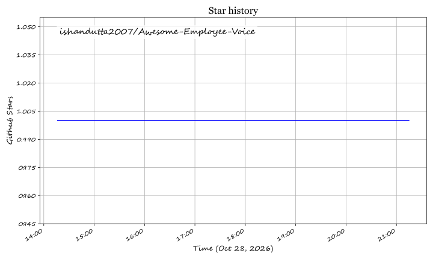

  
  
  
  
  
  
  

# 🗣️ Awesome Employee Voice

  

  <strong>Curated Directory of Top Employee Voice Platforms, Pulse Survey Tools &amp; Open-Source Sentiment Engines</strong>

  <a href="#-sector-overview--market-dynamics">📈 Sector Overview</a> •
  <a href="#-saashosted-platforms">🏢 SaaS Platforms</a> •
  <a href="#-open-source-github-projects">💻 Open-Source Projects</a> •
  <a href="#-key-selection-criteria-for-hr--people-analytics">🎯 Buyer Guide</a> •
  <a href="#-how-to-contribute">🤝 How to Contribute</a> •
  <a href="#-support--sponsorship">💖 Support</a> •
  <a href="#-star-history">⭐ Star History</a>

---

## 📖 Introduction & Ecosystem Scope

**Employee Voice** encompasses the systems, channels, and cultural mechanisms that enable employees to share feedback, raise workplace concerns, voice continuous ideas, and evaluate organizational leadership. 

Modern **Employee Voice platforms** integrate anonymous feedback collection, high-frequency pulse surveys, employee Net Promoter Score (eNPS), and Natural Language Processing (NLP) text analytics to convert qualitative sentiment into actionable leadership decisions.

This repository tracks category-defining **commercial SaaS platforms** and **open-source repositories** designed for HR executives, People Analytics leaders, and engineering teams building continuous listening systems.

---

## 📈 Sector Overview & Market Dynamics

The global Employee Experience Management (EXM) and Employee Voice sector is valued at approximately **$6.4 billion to $7.8 billion** and is projected to expand to **$11 billion – $17+ billion** at a compound annual growth rate (CAGR) of **7%–10%**.

The market is **moderately fragmented**: mega-cap enterprise suites like **Microsoft** (Viva Glint) and **Workday** (Peakon) capture high-volume corporate contracts, alongside dominant specialized experience vendors like **Qualtrics** and **Culture Amp**, while high-velocity mid-market platforms (**Lattice**, **15Five**, **Leapsome**) compete aggressively on agile performance integration and rapid deployment.

---

## 🏢 SaaS/Hosted Platforms

The table below lists category-leading commercial employee voice and engagement platforms, sorted in descending order by **Company Size / Valuation**:

| Platform | Company Size / Valuation | Starting Price (Specific Tier) | Free Tier / Trial Limit | Key Focus & Sentiment Capabilities |
| :--- | :--- | :--- | :--- | :--- |
| **[Glint (Microsoft Viva)](https://www.microsoft.com/en-us/microsoft-viva)** | **$3.1+ Trillion** (Market Cap) | **$2.00/user/month** (Viva Glint standalone add-on, billed annually) | **30-day free trial** (up to 25 seats for Viva Suite / Microsoft 365 trial tenant) | Deep Microsoft 365/Teams native integration; continuous lifecycle listening, AI trend detection & manager action planning. |
| **[Workday Employee Voice (Peakon)](https://www.workday.com/)** | **~$70 Billion** (Market Cap) | **$13.00 – $17.00/user/year** (~$1.08–$1.42/user/mo, min. ~$20,000/yr enterprise entry) | **No self-serve free trial** (Guided sandbox demo upon enterprise sales qualification) | Enterprise benchmark data across 250M+ responses, real-time NLP text classification & automated conversational feedback loops. |
| **[Qualtrics Employee Experience](https://www.qualtrics.com/)** | **$12.5 Billion** (Silver Lake acquisition) | **~$6,500/year base contract** (~$28,000/yr median spend across EX engagement suites) | **30-day free trial** (Qualtrics DesignXM trial; full EX suite requires enterprise scoping) | Enterprise listening engine with Text iQ sentiment analysis, omni-channel feedback intake, and advanced statistical driver modeling. |
| **[Culture Amp](https://www.cultureamp.com/)** | **$2.0 Billion** (Valuation) | **$4,500/year minimum contract** (Engage plan baseline for up to 50–75 seats; ~$5–$14/user/mo) | **No free tier** (Requires customized 14-day assisted pilot via sales demo) | Category-defining people science benchmarks, automated qualitative comment synthesis, heat maps, and manager micro-coaching. |
| **[Lattice](https://lattice.com/)** | **$3.0 Billion** (Valuation) | **$11.00/user/month** (Performance + Engagement bundle, billed annually; $4,000/yr min spend) | **No free tier** (14-day guided proof-of-concept upon sales qualification) | Seamless connection between continuous engagement pulse surveys, 1:1 agendas, OKRs, and 360 performance reviews. |
| **[Perceptyx](https://www.perceptyx.com/)** | **~$1.0 Billion** (Valuation / Francisco Partners backed) | **$6.00/user/month** (Baseline pulse & continuous listening tier; multi-thousand dollar annual floor) | **No free tier** (Interactive enterprise demo environment available on request) | High-volume enterprise continuous listening, multi-channel pulse surveys, predictive attrition modeling, and People Activation consulting. |
| **[Workvivo](https://www.workvivo.com/)** | **~$250 Million** (Acquired by Zoom) | **$20,000/year flat minimum** (Business Plan for up to 250–500 employees; custom enterprise scaling) | **No free tier** (Live interactive product demo via Zoom team on request) | Modern employee intranet combined with pulse checks, public peer recognition, community streams, and exec broadcast surveys. |
| **[15Five](https://www.15five.com/)** | **~$150 Million** (Valuation) | **$4.00/user/month** (Engage standalone plan, billed annually; Perform add-on from $8/user/mo) | **14-day free trial** (Full platform functionality with unlimited user invites for 14 days) | Weekly sentiment pulse checks, asynchronous feedback loops, high-impact manager-employee 1:1 check-in templates. |
| **[Officevibe](https://officevibe.com/)** | **~$100 Million** (Division of Workleap) | **$5.00/user/month** (Essential Plan, billed annually; Pro plan at $7.00/user/month) | **Free Forever Plan** (Restricted to **1 team** and max **30 days of data history**) | Automated 10-question weekly pulse surveys, anonymous employee feedback messaging, eNPS tracking, and team alignment metrics. |
| **[Leapsome](https://www.leapsome.com/)** | **~$100 Million** (Valuation / Series A Insight Partners) | **$8.00/user/month** (Base platform module; software entry starting at $199/month for small teams) | **14-day free trial** (Complete platform access with unlimited survey cycles for up to 14 days) | Modular European compliance-first architecture, anonymous surveys, predictive sentiment trends, and integrated OKR tracking. |

---

## 💻 Open-Source GitHub Projects

Open-source employee voice platforms and survey frameworks ranked in descending order by **GitHub_Stars**:

| Project & Repo | Stars_Badge | Tech Stack | License | Description & Architecture |
| :--- | :--- | :--- | :--- | :--- |
| **[formbricks](https://github.com/formbricks/formbricks)** |  | TypeScript, Next.js, Tailwind, Prisma | AGPL-3.0 | Next-generation open-source survey and experience management suite designed as a privacy-first alternative to Qualtrics; features in-app pulse surveys, webhooks, user segmentation, and eNPS score calculation. |
| **[erxes](https://github.com/erxes/erxes)** |  | TypeScript, Node.js, GraphQL, React | GPL-3.0 / Fair-Code | Source-available experience management and operational operating system; offers custom feedback forms, employee communication widgets, automated survey workflows, and team sentiment tracking. |
| **[LimeSurvey](https://github.com/LimeSurvey/LimeSurvey)** |  | PHP, JavaScript, MySQL, PostgreSQL | GPL-2.0 | Battle-tested, self-hostable survey software with tokenized anonymous response support, multi-lingual question management, branching logic, and comprehensive data export capabilities for organizational surveys. |
| **[threesixty](https://github.com/thermondo/threesixty)** |  | Python, Django, PostgreSQL | MIT | Open-source 360-degree peer and employee feedback system created by Thermondo; facilitates confidential review cycles, peer-to-peer appraisals, and constructive qualitative feedback aggregation. |
| **[blik](https://github.com/thijsdezoete/blik)** |  | TypeScript, React, Docker | MIT | Self-hosted anonymous 360 feedback platform; supports tokenized invite links, pre-configured role assessment templates, analytical radar charts, and anonymous peer response summaries. |
| **[employee-survey-questions](https://github.com/joyouslabs/employee-survey-questions)** |  | Markdown / Open Taxonomy | MIT | Scientifically validated open-source taxonomy and question dataset developed by Joyous Labs for employee experience, pulse surveys, psychological safety, and eNPS measurement. |
| **[Check-Ins](https://github.com/objectcomputing/check-ins)** |  | Java (Micronaut), React, GCP | Apache-2.0 | Full-featured organizational engagement and check-in framework; provides weekly team pulse surveys, peer recognition (kudos), 1:1 agenda tracking, and employee sentiment scoring. |
| **[openpulsesurvey](https://github.com/BrainStation-23/openpulsesurvey)** |  | TypeScript, React, Supabase | MIT | Modern pulse survey tool focused on employee voice; allows automated scheduling of recurring pulse checks, anonymous submissions, and executive analytics dashboards. |
| **[360Survey](https://github.com/pavlokharchenko/360Survey)** |  | Python, Flask, HTML/JS | MIT | Lightweight 360-degree feedback collection tool allowing managers to initiate confidential review questionnaires, collect multi-rater ratings, and generate aggregated summary reports. |
| **[Alignify](https://github.com/iam-tsr/alignify)** |  | Python, DistilBERT, Qwen LLM, Docker | MIT | AI-native anonymous employee engagement platform; features automated question generation via LLM and automated feedback sentiment classification powered by DistilBERT. |
| **[WorkMate](https://github.com/karlis0099/WorkMate)** |  | Java, Spring Boot, Web UI | Apache-2.0 | Employee wellbeing and voice tracker featuring 7 psychological wellbeing sliders, automated burnout alerts, and webhook notifications for high-risk stress trends. |
| **[feedback-hub-core](https://www.npmjs.com/package/feedback-hub-core)** |  | TypeScript (NPM Library) | MIT | Framework-agnostic feedback engine primitives offering department-specific tagging, explainable 0–100 impact scoring algorithms, and follow-up action plan generators. |

---

## 🎯 Key Selection Criteria for HR & People Analytics

When evaluating commercial vs. open-source employee voice software, prioritize the following architecture checkpoints:

1. **🔒 Anonymity Safeguards & Response Thresholds**  
   Strict minimum group sizing (typically `n >= 5` responses) prevents managers from de-anonymizing responses across small departments or demographic segments.
2. **🧠 NLP Sentiment & Qualitative Comment Parsing**  
   Large enterprise deployments generate tens of thousands of open-text comments. Platforms like Peakon and Culture Amp leverage fine-tuned BERT models to extract topics, intent, and sentiment polarity without requiring manual taggers.
3. **📊 Cross-Industry Benchmark Datasets**  
   Raw engagement scores have limited utility in isolation. Commercial platforms provide localized, role-specific, and industry-indexed benchmarks to interpret whether an eNPS of +35 is top-quartile or underperforming.
4. **🔄 Closed-Loop Action Planning**  
   Capturing employee voice without visible leadership follow-through creates survey fatigue. Ensure the platform assigns accountability, tracks milestone completion, and automates progress updates back to teams.

---

## 🤝 How to Contribute

Contributions are warmly welcomed! Help expand this community knowledge base:

1. 🍴 **Fork** this repository.
2. 🌿 **Create** a branch: `git checkout -b feature/new-employee-voice-tool`.
3. 📝 **Add/Update** the tool in `README.md` following the tabular format (include specific pricing, free tier limits, Stars_Badges, and stack details).
4. 📚 Check out more curated collections at [Awesome Awesome Awesome](https://github.com/ishandutta2007/Awesome-Awesome-Awesome).
5. 🚀 **Commit & Push**: Submit a pull request with a concise summary of the addition.

---

## 💖 Support & Sponsorship

If you find this curated directory helpful for your team, organization, or research, please consider supporting the project:

- ⭐ **Star this repository** to help others discover it.
- 🍴 **Fork & share** with your People Ops, HR tech, and engineering colleagues.
- ☕ **Buy me a coffee / Sponsor**: Support continuous curation and open-source updates via the [GitHub Sponsor Dashboard](https://github.com/sponsors/ishandutta2007).

Thank you for championing transparent employee feedback and open workplace analytics! 🙏

---

## 📈 Star History

---

## ⚖️ Disclaimer & Compliance Notice

- This curated list is maintained for informational and educational purposes. Mention does not constitute commercial endorsement.
- Employee voice systems process protected demographic data and sensitive employee opinions. Organizations must ensure strict compliance with **GDPR**, **CCPA**, and regional labor council regulations. Anonymity guarantees and data residency protocols must be verified prior to production rollout.

---

  Built for People Leaders, Chief HR Officers, People Analytics Engineers, and Workplace Experience Specialists.

## Star History

<a href="https://star-history.com/#ishandutta2007/Awesome-Employee-Voice&Timeline" align="center">
  <picture>
    <source media="(prefers-color-scheme: dark)" srcset="assets/ishandutta2007_Awesome-Employee-Voice_growth.svg">
    
  </picture>
</a>
